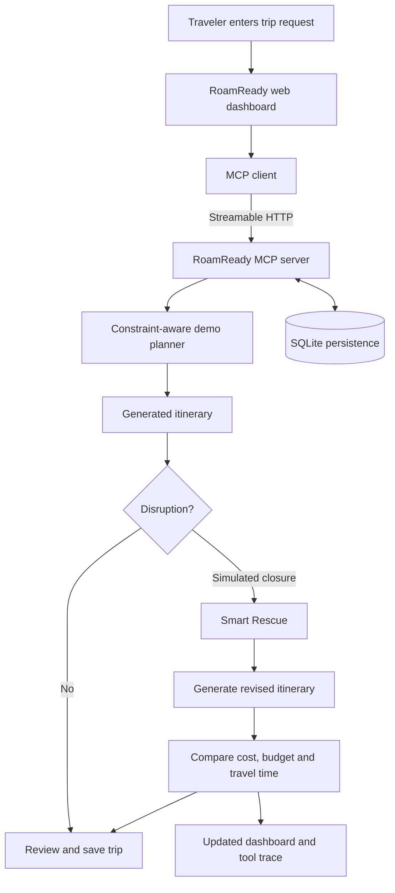

# ✈️ RoamReady AI

### Plan thoughtfully. Adapt confidently. Keep the journey moving.

**An adaptive city-trip planner for the Amazon Build, Ship, Shape Developer Hackathon — Alexa+ track.**

RoamReady AI helps travelers create budget-aware, interest-led itineraries—and then rethink the rest of their journey when plans change. Instead of treating a trip as a fixed checklist, it makes the trade-offs visible and helps travelers compare the original plan with a revised one.

> **The core idea:** When a landmark closes, rebuild the trip around it—not from scratch.

**Plan → Disrupt → Replan → Compare → Save**

[Features](#-what-roamready-ai-does) · [Demo walkthrough](#-demo-walkthrough) · [Architecture](#-how-it-works) · [Run locally](#-run-locally) · [MCP tools](#-mcp-tools) · [Testing](#-testing-and-verification) · [Limitations](#-known-limitations)

---


## 🌍 The idea in one minute

Travel plans are easy to make and surprisingly hard to repair. An attraction can close, weather can change, transport can be disrupted, or a carefully planned day can exceed the available budget. Travelers often have to rebuild the itinerary manually while trying to preserve the things that mattered in the first place.

RoamReady AI explores a more resilient approach:

1. **Plan:** Create a multi-day trip from a budget, group size, interests, and practical constraints.
2. **Disrupt:** Introduce a controlled disruption, such as a landmark closure.
3. **Rescue:** Generate an alternative itinerary around the remaining constraints.
4. **Compare:** Show the estimated changes in trip cost, remaining budget, and local travel time.
5. **Save:** Keep the revised trip and travel preferences for later use.

The current judging scenario uses a simulated Barcelona trip so the experience can be reproduced reliably without depending on external travel APIs.

## ✨ What RoamReady AI does

| Capability | What it demonstrates |
|---|---|
| 🧭 Constraint-aware planning | Builds an itinerary using interests, group size, estimated attraction costs, opening windows, step-free flags, and local travel-time estimates. |
| 💶 Budget transparency | Breaks estimated costs into airfare, accommodation, meals, local transport, and activities. |
| 🔄 Smart Rescue | Rebuilds an itinerary after a simulated attraction closure. |
| 📊 Before-and-after comparison | Compares estimated cost, remaining budget, and local travel time across the original and rescued plans. |
| 🛟 Offline recovery demonstration | Simulates a provider HTTP 503 failure and exercises the local fallback planner. |
| 🔌 MCP integration | Demonstrates MCP initialization, tool discovery, tool invocation, and structured results. |
| 💾 Saved travel context | Supports saved trips, travel profiles, preferences, and SQLite-backed persistence. |
| 🖥️ Interactive dashboard | Brings trip planning, itinerary review, rescue, saved trips, preferences, and visible tool activity together. |

### Why Smart Rescue matters

A replacement recommendation alone does not explain whether a changed plan is actually better. RoamReady AI aims to make the consequences legible: what changed, how the estimated cost moved, how much budget remains, and how the estimated local travel time compares.

The planning and rescue logic in the offline judging scenario is deterministic, which helps judges reproduce the same core flow without API keys or live travel-provider dependencies.

---

## 📊 Smart Rescue at a glance

The figures below are an **illustrative demo result** for a four-day Barcelona trip for two, using a simulated budget of **€1,800**.

| Metric | Original itinerary | Rescued itinerary | Difference |
|:--|--:|--:|--:|
| Estimated trip cost | €1,712 | €1,638 | **−€74** |
| Remaining budget | €88 | €162 | **+€74** |
| Estimated local travel time | 159 min | 127 min | **−32 min** |

### What the example shows

- **€74 lower estimated trip cost** after replanning.
- **€74 more budget remaining** within the same illustrative €1,800 limit.
- **32 fewer estimated local-travel minutes** in the revised itinerary.

These numbers are included to make the comparison easy to understand. They are not live quotes or guaranteed savings; rerun the scenario to inspect the current application output.

> **Demo-data notice:** The Barcelona attraction catalogue, opening windows, disruptions, prices, and local travel times are simulated. They are not verified venue information, live travel estimates, confirmed availability, or booking offers.

---

## 🎬 Demo walkthrough

The demo is designed to show a complete, understandable agent workflow—not just a chat response.

### 1. Ask for a trip

Enter:

```text
Plan a four-day Barcelona trip for two under €1,800; we love architecture, art and food
```

RoamReady AI generates a sample itinerary and an estimated cost breakdown.

### 2. Introduce a disruption

Enter:

```text
Sagrada Família is closed; replan the trip
```

The application runs the controlled closure scenario and generates a revised itinerary.

### 3. Compare the result

Review the original and rescued plans, including the estimated cost, remaining budget, local travel time, and visible MCP activity.

### 4. Exercise recovery

Enter:

```text
Simulate a flight provider failure and recover offline
```

The app injects a local simulated provider failure and exercises the offline recovery flow. This controlled scenario does not send a request to an external flight provider.

**Important:** The demo does not make reservations or purchases. Simulated outputs should not be used to make real travel, payment, or accessibility decisions.

---

## 🧠 How it works



The browser dashboard acts as an MCP client. It sends requests to the self-hosted MCP server, receives structured tool results, and updates the interface.

In deterministic demo mode, local intent routing powers the core judging scenario. This means the core workflow does not require an external large language model or travel provider.

### System architecture


### Technology stack

| Layer | Technology |
|---|---|
| Language | Python |
| MCP server | MCP Python SDK / FastMCP |
| Transport | Streamable HTTP |
| Web framework | Starlette |
| ASGI server | Uvicorn |
| Persistence | SQLite |
| Frontend | HTML, CSS, JavaScript |
| Motion | GSAP 3.15 + ScrollTrigger + MotionPath (version-pinned CDN, with a static fallback; [license](https://gsap.com/standard-license/)) |
| Typography | DM Sans + Playfair Display (Google Fonts, with system-font fallbacks) |
| Tests | pytest |

The overview's scroll-linked 3D itinerary story uses the locally stored, attributed Barcelona photograph listed in [`web/static/ASSETS.md`](web/static/ASSETS.md). It does not include a Veo 3-generated video; the UI labels the sequence as a story preview and directs users to Smart Rescue for actual MCP-generated itinerary results.

### Alexa+ track scope

RoamReady AI demonstrates a self-hosted MCP server and a browser-based MCP client. The local release audit reports that the server implements MCP protocol version **`2025-11-25`**.

The browser experience is an **Alexa+-style simulator**, not a live Alexa+ device integration. The project does not claim restricted Alexa+ preview access, Amazon certification, or a connection to a physical Echo device.

---

## 🔌 MCP tools

The custom MCP tool set includes:

| Tool | Purpose |
|---|---|
| `plan_demo_trip` | Generates the deterministic demo trip. |
| `rescue_demo_trip_tool` | Generates a revised itinerary after the demo disruption. |
| `simulate_provider_failure` | Exercises the simulated provider-failure and recovery flow. |
| `plan_local_itinerary` | Plans a local itinerary. |
| `rescue_itinerary_tool` | Exercises the itinerary rescue workflow. |
| `set_travel_profile` | Updates travel preferences. |
| `get_travel_profile` | Retrieves travel preferences. |
| `list_saved_trips` | Retrieves saved trips. |
| `forget_travel_memory` | Deletes the current demo user's saved travel memory. |

The server also retains upstream flight, hotel, package-search, and price-watch tools. Those optional paths may make outbound requests and are not required for the offline judging scenario.

### Inspect the MCP server

Start the server using the documented entry point:

```bash
python -m trip_scout.server
```

Connect MCP Inspector to:

```text
http://127.0.0.1:8765/mcp
```

For offline inspection, try `plan_demo_trip`, `rescue_demo_trip_tool`, or `simulate_provider_failure`. Avoid optional live-search and price-watch tools when testing offline.

---

## 🚀 Run locally

### Prerequisites

- Python 3.10 or later
- `pip`
- A modern browser

The deterministic offline scenario requires no API key, LLM, AWS account, or external travel provider.

### 1. Clone the repository

```bash
git clone https://github.com/ManyaValecha/roamready-ai.git
cd roamready-ai
```

### 2. Create and activate a virtual environment

macOS / Linux:

```bash
python3 -m venv .venv
source .venv/bin/activate
```

Windows PowerShell:

```powershell
.venv\Scripts\Activate.ps1
```

### 3. Install dependencies

```bash
python -m pip install -r requirements.txt
```

### 4. Configure the environment

macOS / Linux:

```bash
cp .env.example .env
set -a
source .env
set +a
```

On Windows, copy `.env.example` to `.env` and configure the variables using your normal PowerShell workflow.

### 5. Launch the demo

```bash
python run_demo.py --no-browser
```

Open the dashboard:

- **Web dashboard:** `http://127.0.0.1:8770`
- **Local MCP endpoint:** `http://127.0.0.1:8765/mcp`

Keep the application running while using the dashboard.

---

## ⚙️ Configuration

| Variable | Purpose |
|---|---|
| `ROAMREADY_DEMO_MODE` | `1` enables deterministic local routing; `0` enables the optional LLM path. |
| `TRIP_SCOUT_DB` | SQLite database path. |
| `TRIP_SCOUT_HOST` | MCP listener host; defaults to `127.0.0.1`. |
| `TRIP_SCOUT_PORT` | MCP listener port; defaults to `8765`. |
| `TRIP_SCOUT_TOKEN` | Optional bearer token for protected requests. |
| `TRIP_SCOUT_ALLOWED_HOSTS` | MCP host allow-list. |
| `TRIP_SCOUT_ALLOWED_ORIGINS` | MCP origin allow-list. |
| `TRIP_SCOUT_MCP_URL` | MCP endpoint used by the simulator. |
| `LLM_BASE_URL` | Optional OpenAI-compatible chat endpoint. |
| `LLM_API_KEY` | Optional LLM credential. |
| `LLM_MODEL` | Optional model identifier. |
| `LLM_PROVIDER` | Optional provider selector; set to `bedrock` to use Amazon Bedrock's OpenAI-compatible Chat Completions endpoint. |
| `AWS_REGION` | Bedrock region used to construct the recommended `bedrock-runtime` endpoint when `LLM_BASE_URL` is unset. |
| `AWS_BEARER_TOKEN_BEDROCK` | Optional Bedrock API key; never commit or paste it into issue trackers. |

Never commit real API keys, tokens, or private environment files.

### Optional Amazon Bedrock model provider

The simulator contains an opt-in Amazon Bedrock Chat Completions integration. This is separate from the deterministic judging demo: normal setup leaves `ROAMREADY_DEMO_MODE=1`, which makes no model request. To opt in, use a Bedrock API key with model access and set `LLM_PROVIDER=bedrock`, `AWS_REGION`, and `AWS_BEARER_TOKEN_BEDROCK` in your local ignored `.env`; optionally set `LLM_MODEL` or `LLM_BASE_URL` for a compatible model/endpoint. Then set `ROAMREADY_DEMO_MODE=0` to enable the LLM host. A model invocation may incur AWS charges. Never commit `.env` or expose the bearer token. The request path is covered by a network-free unit test; no live Bedrock request or AWS account was available for this audit, so live service access is unverified. See the [AWS Chat Completions endpoint documentation](https://docs.aws.amazon.com/bedrock/latest/userguide/inference-chat-completions.html).

---

## 🧪 Testing and verification

Run the focused regression suite:

```bash
python -m pytest -p no:capture -q tests/test_units.py tests/test_roamready_mcp.py tests/test_web_reset.py
```

The 22 October 2026 regression run after profile-input validation reports **23 passing tests** for the command below. In this managed environment, `-p no:capture` is needed because pytest's native readline capture workaround crashes the interpreter. The live Bedrock service was not called; its request construction is tested with a fake HTTP client.

Additional checks reported during the audit:

```bash
node --check web/static/app.js
python -m compileall -q trip_scout web run_demo.py
git diff --check
```

Reported coverage includes planner constraints, mocked provider success and HTTP 503 behavior, MCP integration, saved-trip deletion, accessibility filtering, and web-session reset behavior.

The live-provider smoke script `tests/smoke_mcp.py` is intentionally excluded from the safe test command because it sends real outbound requests.

See [`docs/FINAL_AUDIT.md`](docs/FINAL_AUDIT.md) for the detailed verification record and known limitations.

---

## 🔐 Privacy and data lifecycle

RoamReady AI supports local persistence for saved trips and preferences.

- **Reset demo session:** clears the current conversation and generated comparison while preserving saved preferences and trips.
- **Forget all travel memory:** deletes the current demo user's profile, saved trips, and price watches.

The second action is destructive; use it carefully.

---

## ⚠️ Known limitations and responsible use

RoamReady AI is a hackathon prototype, not a live travel-booking service.

- The Barcelona attraction catalogue, opening windows, ticket estimates, disruptions, and local travel times are illustrative.
- The simulated budget assumes €620 for round-trip airfare for two, €160 per night for three nights, €70 per day for four days of meals, and €40 per traveler for local transport.
- Optional flight and hotel searches parse public Google Travel result pages. These are unofficial integrations, not official Google APIs; production-use terms have not been verified.
- The offline demo does not verify live closures, opening hours, prices, or route durations.
- No real Alexa+ device integration, restricted preview access, OAuth onboarding, Amazon certification, or verified live AWS invocation is claimed. Amazon Bedrock is an optional, documented LLM endpoint; deterministic demo mode does not call it.
- SQLite is single-node persistence. Multi-instance deployment would require a suitable shared-storage design.

Do not use simulated results as the basis for real travel purchases or accessibility decisions.

---

## ☁️ Deployment

The repository includes a demo-oriented Vercel entry point. See [`docs/VERCEL.md`](docs/VERCEL.md) for configuration.

The deployment design keeps simulated planning and rescue enabled, protects MCP requests with a bearer token, signs browser session IDs, and blocks live-provider tools in the web proxy.

SQLite uses `/tmp` in this deployment configuration, so saved trips and preferences may be cleared between instances or restarts.

**Deployment code does not mean a public deployment is live.** Add a public URL only after independently verifying it.

---

## 📁 Project documentation

| Document | Description |
|---|---|
| [`DEMO.md`](DEMO.md) | Timed demo script. |
| [`FEATURE_MATRIX.md`](FEATURE_MATRIX.md) | Feature comparison and code provenance. |
| [`SUBMISSION.md`](SUBMISSION.md) | Hackathon submission checklist. |
| [`docs/FINAL_AUDIT.md`](docs/FINAL_AUDIT.md) | Technical audit and verification. |
| [`docs/FEEDBACK.md`](docs/FEEDBACK.md) | Developer-tool feedback. |
| [`docs/VERCEL.md`](docs/VERCEL.md) | Deployment configuration. |
| [`web/static/ASSETS.md`](web/static/ASSETS.md) | Static asset attribution. |

---

## 📜 License and attribution

The repository preserves the MIT license in [`LICENSE`](LICENSE). See the license file, [`FEATURE_MATRIX.md`](FEATURE_MATRIX.md), and asset attribution documentation for provenance details.

Review third-party provider terms before distributing or enabling optional live-search functionality.

---

<p align="center">

**RoamReady AI**

*Plan thoughtfully. Adapt confidently. Keep the journey moving.*

Built for the Amazon Build, Ship, Shape Developer Hackathon · Alexa+ Track

</p>
