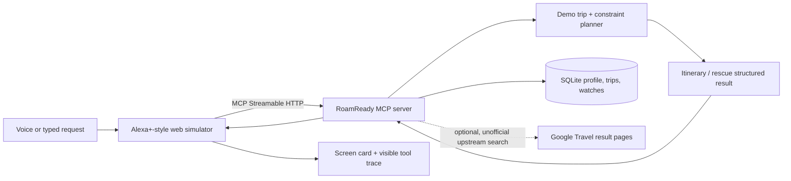

# RoamReady AI

**When a landmark closes, rebuild the trip around it.** RoamReady helps independent travelers plan a short city break around their interests and hard budget, then makes the disruption tradeoff visible. Its four-day Barcelona demo for two compares the original and rescued itinerary, cost and estimated local travel time.

All amounts, venue hours, disruptions and local travel times in the four-day judging scenario are **simulated estimates**, not live quotes, confirmed availability or official venue information. No booking or purchase is made. The optional upstream flight and hotel search fetches public Google Travel result pages; they are unofficial integrations, not official Google APIs. The project has not verified their current terms for production use.

The old package-search screenshot has been removed because its dated sample prices could be mistaken for current quotes. For current UI evidence, run the reproducible backend flow in [DEMO.md](DEMO.md); capture the live four-day result and rescue comparison for the submission video/media. Every value in that demo is labeled simulated.

## What it does

- Builds a personalized itinerary using selected interests, group size, attraction ticket estimates, opening windows, step-free flags, area-to-area travel-time estimates and a hard activity allocation inside the trip budget.
- Shows a transparent trip estimate with airfare, lodging, meals, local transport and activities as separate line items. The fixed assumptions and simulated-data label are shown with the result.
- Rebuilds the same four-day itinerary after a simulated closure and shows the before/after plans, total estimate change, remaining-budget change and local travel-time change.
- Injects a local simulated provider 503 and recovers using the offline demo planner; the recovery result is labeled as simulated.
- Runs a real MCP client flow: `initialize` → `tools/list` → `tools/call` → structured result → updated screen card. The activity panel shows the calls and results.
- Retains Trip Scout's optional flight/hotel searches, saved profiles, price watches and SQLite memory. These upstream search paths require internet and are not used by the reproducible offline demo.

### Architecture



The older Alexa Trip Planner's attraction-routing concept informed the new planner, but its source was not copied: the clone had no license file and contained embedded credentials. The MIT-licensed Trip Scout code supplies the upstream package search, MCP scaffolding, simulator and persistence. See [FEATURE_MATRIX.md](FEATURE_MATRIX.md) for the verified feature-by-feature comparison and provenance.

## Requirements and local setup

- Python 3.10 or later
- `pip`
- For the offline judging scenario: no API key, LLM, AWS account or external travel provider
- A browser for the responsive simulator; microphone support depends on browser speech-recognition support

From the repository root, run:

```sh
python3 -m venv .venv
source .venv/bin/activate                 # Windows PowerShell: .venv\Scripts\Activate.ps1
python -m pip install -r requirements.txt
cp .env.example .env                      # Windows PowerShell: Copy-Item .env.example .env
set -a; source .env; set +a               # PowerShell users can set the variables from .env manually
python run_demo.py --no-browser
```

Open **http://127.0.0.1:8770**. `ROAMREADY_DEMO_MODE=1` is set in the example environment: turns use deterministic local intent routing and do not call an external LLM. In **Demo & help**, choose **Reset demo session** to clear the current conversation and generated comparison while preserving saved preferences and trips. The separate **Forget all travel memory** action permanently deletes the current demo user's profile, saved trips and watches.

Type or say:

1. `Plan a four-day Barcelona trip for two under €1,800; we love architecture, art and food`
2. `Sagrada Família is closed; replan the trip`
3. `Simulate a flight provider failure and recover offline`

The flow calls the MCP backend for each request and renders each `structuredContent` result. The failure is injected locally, so it makes no provider request. Web assets, including the CC0 hero image attribution, are documented in [web/static/ASSETS.md](web/static/ASSETS.md).

## Configuration

`.env.example` documents all settings. Source it before starting the demo as shown above. Key settings:

- `ROAMREADY_DEMO_MODE=1`: deterministic offline router; set to `0` to use the optional OpenAI-compatible LLM host.
- `TRIP_SCOUT_DB`: SQLite file (example setting `~/.trip_scout/roamready.db`; the code uses this same fallback when the variable is absent).
- `TRIP_SCOUT_HOST`, `TRIP_SCOUT_PORT`: MCP listener; defaults to `127.0.0.1:8765`.
- `TRIP_SCOUT_TOKEN`: optional bearer token; set the same value for MCP and simulator services.
- `TRIP_SCOUT_ALLOWED_HOSTS`, `TRIP_SCOUT_ALLOWED_ORIGINS`: MCP transport security allow-lists.
- `TRIP_SCOUT_MCP_URL`: MCP endpoint used by the simulator; defaults to `http://127.0.0.1:8765/mcp`.
- `LLM_BASE_URL`, `LLM_API_KEY`, `LLM_MODEL`: optional OpenAI-compatible chat endpoint. Do not commit credentials.

## MCP server and client

The server implements MCP **2025-11-25** over Streamable HTTP. The observed initialize response during the release audit reported protocol version `2025-11-25`.

- Local MCP endpoint: `http://127.0.0.1:8765/mcp`
- The web simulator is itself an MCP client and executes `initialize`, `tools/list`, and `tools/call` against this endpoint.
- To inspect it with MCP Inspector, start the server with `python -m trip_scout.server`, then connect Inspector to the Streamable HTTP URL above. For a safe call, invoke `plan_demo_trip`, `rescue_demo_trip_tool`, or `simulate_provider_failure`; these are offline tools. Avoid `plan_trip`, `search_flights`, `search_hotels`, `find_cheapest_dates`, `watch_price` and `check_price_watches` unless you intend to make outbound requests to the unofficial Google Travel result-page integrations.

The custom MCP tool set includes `plan_demo_trip`, `rescue_demo_trip_tool`, `simulate_provider_failure`, `plan_local_itinerary`, `rescue_itinerary_tool`, `set_travel_profile`, `get_travel_profile`, `list_saved_trips`, `forget_travel_memory`, and the retained flight/hotel/package/price-watch tools. No tool books or reserves anything. The simulator is Alexa+-style, not an Alexa device integration.

## Tests and observed results

Install the requirements above, then run:

```sh
python -m pytest -q tests/test_units.py tests/test_roamready_mcp.py tests/test_web_reset.py
```

The verified local environment passed **19 tests** with:

```sh
python -m pytest -q tests/test_units.py tests/test_roamready_mcp.py tests/test_web_reset.py
```

Coverage includes unit and planner constraints, mocked provider success/503 behavior, Streamable HTTP MCP integration, stored trip deletion, accessibility filtering, and web session reset behavior. The live provider smoke script `tests/smoke_mcp.py` is deliberately not part of the safe test command because it sends real outbound search requests; mock coverage is used instead. The dashboard JavaScript also passed `node --check web/static/app.js`.

See [docs/FINAL_AUDIT.md](docs/FINAL_AUDIT.md) for exact commands, protocol handshake, end-to-end checks, secret scan and limitations.

## Known limitations

- The Barcelona catalog, travel minutes, opening hours, ticket costs and disruption state are illustrative. They must be replaced with licensed, verified feeds before real travel decisions.
- Upstream live flight/hotel code parses public Google Travel result pages, not an official provider API. Terms authorization has not been verified here; treat as experimental and do not present results as guaranteed or production-ready.
- The local demo budget assumes €620 round-trip airfare for two, €160/night × 3 nights, €70/day × 4 days for meals, and €40 per traveler for local transit. Every line is labeled simulated; this is not a bookable offer.
- No real Alexa device, restricted Alexa+ preview tools, OAuth onboarding, AWS integration or public HTTPS deployment was used or verified.
- SQLite is single-node persistence; multi-instance deployment needs a shared storage migration.

## License and attribution

The project preserves Trip Scout's MIT license in [LICENSE](LICENSE). RoamReady AI's original demo planner and additions are MIT-licensed by the project contributors as indicated in the license file. Upstream attribution and the feature matrix are included. No source or credentials were copied from the older unlicensed Alexa Trip Planner. Review the original licenses and third-party provider terms before distributing or enabling live search.

## Deployment

The Vercel entry point is a demo-only, single-function ASGI deployment. It keeps simulated planning and rescue enabled, requires a private bearer token for MCP HTTP requests, signs browser session IDs, and blocks live-provider tools in the web proxy. SQLite uses `/tmp`, which Vercel may clear between instances or restarts; saved trips and preferences are temporary. No database or other paid resource is provisioned. See [docs/VERCEL.md](docs/VERCEL.md) for setup. A successful local build is not a public deployment; add the deployed URL only after verifying it.

## Submission/demo materials

- [Timed demo script](DEMO.md)
- [Feature and provenance matrix](FEATURE_MATRIX.md)
- [Hackathon submission checklist](SUBMISSION.md)
- [Product feedback for components actually used](docs/FEEDBACK.md)
