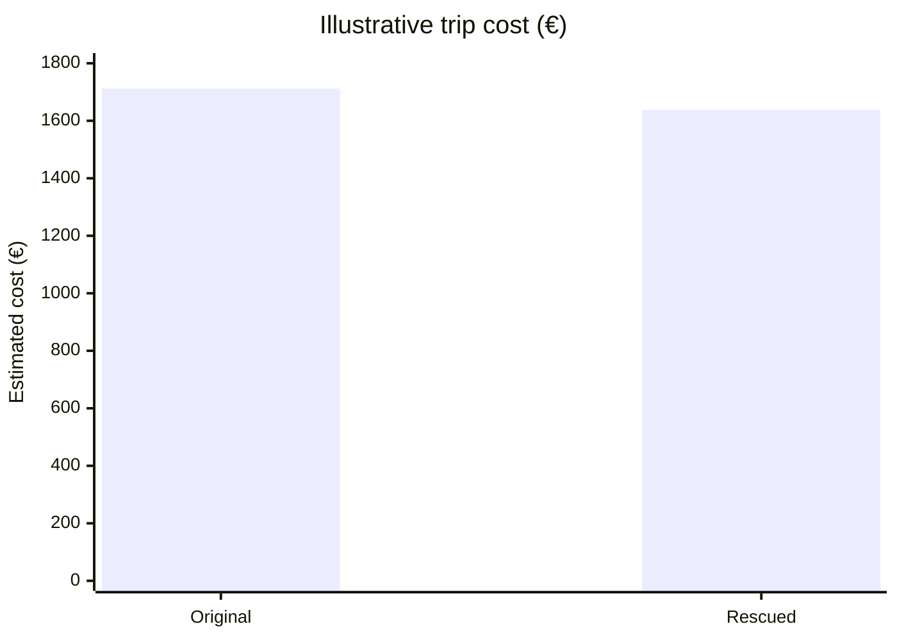
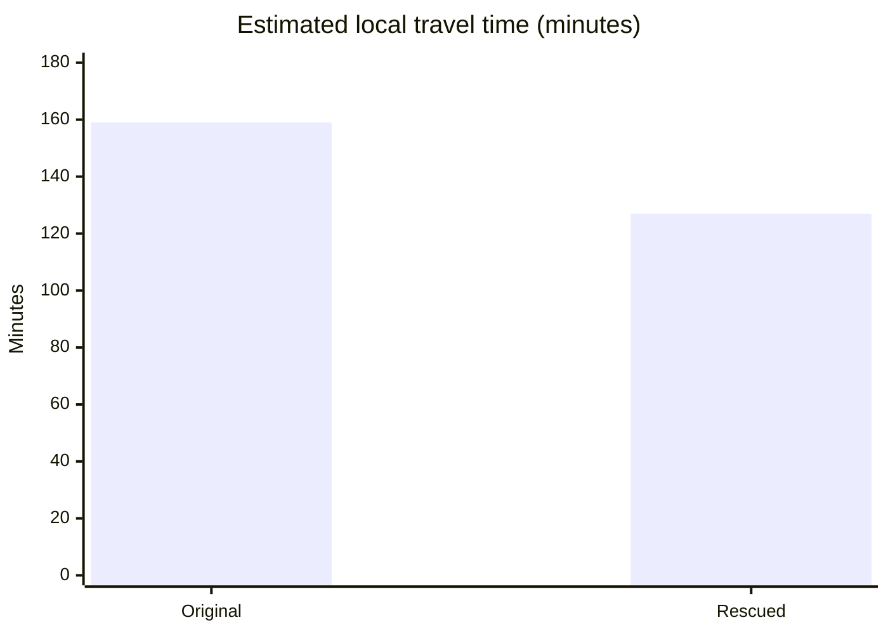
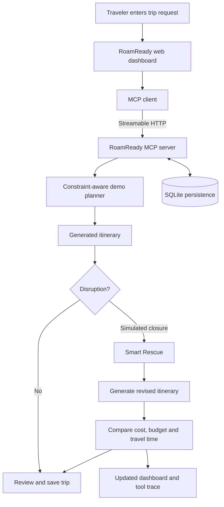
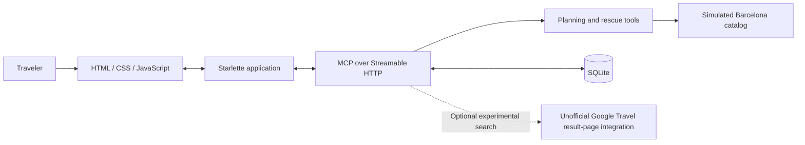

# ✈️ RoamReady AI
### When a landmark closes, rebuild the trip around it.

**Plan within your budget. Travel around your interests. Adapt when reality changes.**

RoamReady AI is an adaptive city-trip planning prototype built for the **Amazon Build, Ship, Shape Developer Hackathon — Alexa+ track**. It helps travelers plan around their interests and budget, then makes the trade-offs visible when an unexpected disruption changes their itinerary.

Instead of treating an itinerary as a static checklist, RoamReady demonstrates a more resilient journey:

**Plan → Disrupt → Replan → Compare → Save**

> **Important:** The Barcelona judging scenario uses simulated attraction information, opening windows, disruptions, prices, and local travel times. These are not live quotes, verified venue information, or confirmed availability. The application does not make bookings or purchases.

<p align="center">
  <strong>One itinerary. One unexpected closure. A smarter way to compare the alternatives.</strong>
</p>

---

## 📊 Smart Rescue at a glance

The following figures represent an illustrative four-day Barcelona trip for two, using a simulated budget of €1,800.

| Metric | Original itinerary | Rescued itinerary | Change |
|:--|--:|--:|--:|
| Estimated trip cost | €1,712 | €1,638 | **−€74** |
| Remaining budget | €88 | €162 | **+€74** |
| Estimated local travel time | 159 min | 127 min | **−32 min** |

### Visual comparison





In this example, Smart Rescue reduces the estimated trip cost by €74, leaves €74 more of the budget unspent, and reduces estimated local travel time by 32 minutes.

*All figures above are illustrative demo outputs, not live travel information. Re-run the scenario to verify the current application results.*

---

## 🎯 The problem

Travel plans rarely survive every change.

An attraction might close. Travel time might increase. A budget might leave little room for alternatives. Rebuilding the entire itinerary manually can mean starting over and losing sight of the original constraints.

RoamReady AI explores a different approach: **rebuild the plan while making the consequences visible.**

## ✨ Key features

| Feature | What it does |
|:--|:--|
| 🧭 Constraint-aware planning | Uses interests, group size, estimated attraction costs, opening windows, step-free flags, and local travel-time estimates. |
| 💶 Budget transparency | Separates estimated airfare, lodging, meals, local transport, and activities. |
| 🔄 Smart Rescue | Rebuilds the itinerary after a simulated attraction closure. |
| 📈 Before-and-after comparison | Shows changes in estimated trip cost, remaining budget, and local travel time. |
| 🛟 Offline recovery demo | Simulates a provider HTTP 503 and exercises the local offline planner. |
| 🔌 MCP tool integration | Uses MCP initialization, tool discovery, and tool calls with structured results. |
| 💾 Saved travel context | Supports saved trips, profiles, preferences, and SQLite-backed persistence. |
| 🖥️ Interactive dashboard | Provides planning, itinerary, rescue, saved-trip, and preferences views. |

## 🧠 How it works



The dashboard acts as an MCP client. It sends requests to the self-hosted MCP server, receives structured tool results, and updates the interface.

The deterministic demo mode uses local intent routing and does not require an external LLM or travel provider for the core judging scenario.

## 🏗️ Architecture



### Technology stack

- **Language:** Python
- **MCP:** MCP Python SDK / FastMCP
- **Transport:** Streamable HTTP
- **Web framework:** Starlette
- **ASGI server:** Uvicorn
- **Persistence:** SQLite
- **Frontend:** HTML, CSS, JavaScript
- **Testing:** pytest

### Alexa+ track clarification

RoamReady AI demonstrates a self-hosted MCP server and browser-based MCP client. The server implements MCP protocol version `2025-11-25`, as reported by the local release audit.

The browser interface is an Alexa+-style simulator, **not a live Alexa+ device integration**. No restricted Alexa+ preview access, Amazon certification, or real-device connection is claimed.

## 🚀 Run locally

### Prerequisites

- Python 3.10 or later
- `pip`
- A modern browser

The deterministic offline scenario requires no API key, LLM, AWS account, or external travel provider.

### 1. Clone the repository

```bash
git clone https://github.com/ManyaValecha/roamready-ai.git
cd roamready-ai
```

### 2. Create a virtual environment

```bash
python3 -m venv .venv
source .venv/bin/activate
```

Windows PowerShell:

```powershell
.venv\Scripts\Activate.ps1
```

### 3. Install dependencies

```bash
python -m pip install -r requirements.txt
```

### 4. Configure the environment

```bash
cp .env.example .env
set -a
source .env
set +a
```

On Windows, copy `.env.example` to `.env` and configure the variables using your normal PowerShell workflow.

### 5. Launch RoamReady AI

```bash
python run_demo.py --no-browser
```

Open the dashboard:

**http://127.0.0.1:8770**

Local MCP endpoint:

**http://127.0.0.1:8765/mcp**

Keep the application running while using the dashboard.

## 🧪 Try the demo

Enter these requests in order.

**1 — Plan the trip**

```text
Plan a four-day Barcelona trip for two under €1,800; we love architecture, art and food
```

**2 — Simulate a disruption**

```text
Sagrada Família is closed; replan the trip
```

**3 — Test offline recovery**

```text
Simulate a flight provider failure and recover offline
```

Inspect the generated itinerary, simulated cost breakdown, Smart Rescue comparison, and visible MCP activity.

The closure and provider failure are controlled demo scenarios. The simulated failure is injected locally and does not make an external provider request.

## 🔌 MCP tools

The custom MCP tool set includes:

| Tool | Purpose |
|:--|:--|
| `plan_demo_trip` | Generate the deterministic demo trip. |
| `rescue_demo_trip_tool` | Generate a revised itinerary after the demo disruption. |
| `simulate_provider_failure` | Exercise the simulated provider-failure and recovery flow. |
| `plan_local_itinerary` | Plan a local itinerary. |
| `rescue_itinerary_tool` | Exercise the itinerary rescue workflow. |
| `set_travel_profile` | Update travel preferences. |
| `get_travel_profile` | Retrieve travel preferences. |
| `list_saved_trips` | Retrieve saved trips. |
| `forget_travel_memory` | Delete the current demo user's saved travel memory. |

The server also retains upstream flight, hotel, package-search, and price-watch tools. Those optional paths can make outbound requests and are not required for the offline judging scenario.

### Inspect the MCP server

Start the server using the documented entry point:

```bash
python -m trip_scout.server
```

Connect MCP Inspector to:

```text
http://127.0.0.1:8765/mcp
```

For offline inspection, use `plan_demo_trip`, `rescue_demo_trip_tool`, or `simulate_provider_failure`.

Avoid optional live-search and price-watch tools when testing offline.

## ⚙️ Configuration


| Variable | Description |
|:--|:--|
| `ROAMREADY_DEMO_MODE` | `1` enables deterministic local routing; `0` enables the optional LLM path. |
| `TRIP_SCOUT_DB` | SQLite database path. |
| `TRIP_SCOUT_HOST` | MCP listener host; defaults to `127.0.0.1`. |
| `TRIP_SCOUT_PORT` | MCP listener port; defaults to `8765`. |
| `TRIP_SCOUT_TOKEN` | Optional bearer token for protected requests. |
| `TRIP_SCOUT_ALLOWED_HOSTS` | MCP host allow-list. |
| `TRIP_SCOUT_ALLOWED_ORIGINS` | MCP origin allow-list. |
| `TRIP_SCOUT_MCP_URL` | MCP endpoint used by the simulator. |
| `LLM_BASE_URL` | Optional OpenAI-compatible chat endpoint. |
| `LLM_API_KEY` | Optional LLM credential. |
| `LLM_MODEL` | Optional model identifier. |

Never commit real API keys, tokens, or private environment files.

## 🧪 Tests

Run the focused regression suite:

```bash
python -m pytest -q tests/test_units.py tests/test_roamready_mcp.py tests/test_web_reset.py
```

The reported local release-audit run passed **19 tests**. Re-run the command to verify the current checkout.

Additional checks reported during the audit included:

```bash
node --check web/static/app.js
python -m compileall -q trip_scout web run_demo.py
git diff --check
```

Coverage includes planner constraints, mocked provider success and HTTP 503 behavior, MCP integration, saved-trip deletion, accessibility filtering, and web-session reset behavior.

The live-provider smoke script `tests/smoke_mcp.py` is intentionally excluded from the safe test command because it sends real outbound requests.

See [docs/FINAL_AUDIT.md](docs/FINAL_AUDIT.md) for the detailed verification record and known limitations.

## 🔐 Privacy and data lifecycle

RoamReady AI supports local persistence for saved trips and preferences.

- **Reset demo session:** clears the current conversation and generated comparison while preserving saved preferences and trips.
- **Forget all travel memory:** deletes the current demo user's profile, saved trips, and price watches.

The second action is destructive. Use it carefully.

## ⚠️ Known limitations

RoamReady AI is a hackathon prototype, not a live travel-booking service.

- The Barcelona attraction catalog, opening windows, ticket estimates, disruptions, and local travel times are illustrative.
- The simulated budget assumes €620 for round-trip airfare for two, €160 per night for three nights, €70 per day for four days of meals, and €40 per traveler for local transport.
- Optional flight and hotel searches parse public Google Travel result pages. These are unofficial integrations, not official Google APIs; production-use terms have not been verified.
- The offline demo does not verify live closures, opening hours, prices, or route durations.
- No real Alexa+ device integration, restricted preview access, OAuth onboarding, Amazon certification, or AWS integration is claimed.
- SQLite is single-node persistence. Multi-instance deployment would require a suitable shared-storage design.

Do not use simulated results as the basis for real travel purchases or accessibility decisions.

## ☁️ Deployment

The repository includes a demo-oriented Vercel entry point. See [docs/VERCEL.md](docs/VERCEL.md) for configuration.

The deployment design keeps simulated planning and rescue enabled, protects MCP requests with a bearer token, signs browser session IDs, and blocks live-provider tools in the web proxy.

SQLite uses `/tmp` in this deployment configuration, so saved trips and preferences may be cleared between instances or restarts.

**Deployment code does not mean a public deployment is live.** Add a public URL only after independently verifying it.

## 📁 Project documentation

| Document | Description |
|:--|:--|
| [DEMO.md](DEMO.md) | Timed demo script. |
| [FEATURE_MATRIX.md](FEATURE_MATRIX.md) | Feature comparison and code provenance. |
| [SUBMISSION.md](SUBMISSION.md) | Hackathon submission checklist. |
| [docs/FINAL_AUDIT.md](docs/FINAL_AUDIT.md) | Technical audit and verification. |
| [docs/FEEDBACK.md](docs/FEEDBACK.md) | Developer-tool feedback. |
| [docs/VERCEL.md](docs/VERCEL.md) | Deployment configuration. |
| [web/static/ASSETS.md](web/static/ASSETS.md) | Static asset attribution. |

## 📜 License and attribution

The repository preserves the MIT license in [LICENSE](LICENSE). See the license file, [FEATURE_MATRIX.md](FEATURE_MATRIX.md), and asset attribution documentation for provenance details.

Review third-party provider terms before distributing or enabling optional live-search functionality.

---

<p align="center">
  <strong>RoamReady AI</strong><br/>
  <em>Plan thoughtfully. Adapt confidently. Keep the journey moving.</em>
</p>

<p align="center">
  Built for the Amazon Build, Ship, Shape Developer Hackathon · Alexa+ Track
</p>
