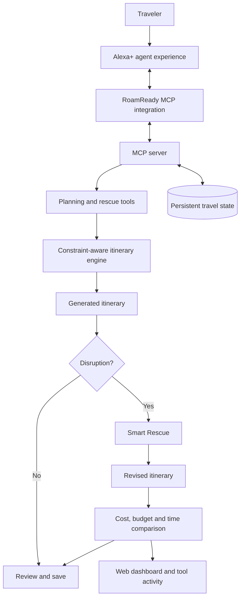
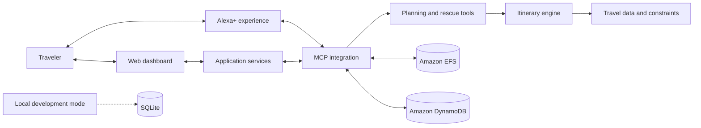

# ✈️ RoamReady AI

### Plan thoughtfully. Adapt confidently. Keep the journey moving.

**An autonomous itinerary planning and rescue agent built for the Amazon Build, Ship, Shape Developer Hackathon — Alexa+ Track.**

RoamReady AI helps travelers create budget-aware, interest-led city itineraries and adapt intelligently when plans change. Rather than treating a trip as a fixed checklist, it coordinates planning, disruption recovery, constraint-aware replanning, and before-and-after comparisons through an agentic travel experience.

**The core idea:** When a landmark closes, rebuild the journey around the disruption—not from scratch.

**Plan → Disrupt → Rescue → Compare → Save**

[](https://youtu.be/Dtg5vYwNLeU)

<p align="center">
  <a href="https://youtu.be/Dtg5vYwNLeU"><strong>▶ Watch the Demo</strong></a>
  ·
  <a href="https://devpost.com/software/roamready-ai-autonomous-itinerary-rescue-agent-for-alexa"><strong>🏆 Devpost Submission</strong></a>
  ·
  <a href="https://github.com/ManyaValecha/roamready-ai"><strong>💻 Source Code</strong></a>
  ·
  <a href="https://roamready-ai-mt6f.vercel.app/"><strong>🌐 Web Demo</strong></a>
</p>

---

## 🌍 The problem: Travel plans break. Travelers shouldn't have to start over.

A carefully planned trip can unravel when an attraction closes, transportation becomes unavailable, the weather changes, or the itinerary no longer fits the traveler's budget.

Most planning experiences focus on generating an itinerary. RoamReady AI focuses on what happens **after the original plan stops working**.

The agent helps travelers preserve their interests and constraints while adapting the remaining journey, then makes the consequences of those changes visible.

### The five-step experience

1. **Plan:** Create a multi-day itinerary based on destination, budget, group size, interests, and practical constraints.
2. **Disrupt:** Introduce a travel disruption, such as a landmark closure.
3. **Rescue:** Replan the affected journey while considering the remaining constraints.
4. **Compare:** Evaluate estimated cost, remaining budget, and local travel time before and after replanning.
5. **Save:** Preserve the revised itinerary and travel preferences for future use.

The result is a travel-planning experience designed around resilience, transparency, and continuity—not just itinerary generation.

## ✨ What RoamReady AI does

| Capability | What it delivers |
|---|---|
| 🧭 Constraint-aware planning | Builds itineraries around traveler interests, group size, budget, attraction costs, opening windows, and accessibility-related constraints. |
| 💶 Budget transparency | Breaks estimated trip costs into airfare, accommodation, meals, local transportation, and activities. |
| 🔄 Smart Rescue | Rebuilds an itinerary after a disruption instead of requiring the traveler to restart the planning process. |
| 📊 Before-and-after comparison | Makes changes to estimated cost, remaining budget, and local travel time easy to evaluate. |
| 🛟 Resilient recovery | Demonstrates recovery from a simulated provider HTTP 503 failure through a local fallback path. |
| 🔌 MCP integration | Uses the Model Context Protocol to expose planning, rescue, and travel-context capabilities as structured tools. |
| 💾 Persistent travel context | Supports saved trips and traveler preferences through the application's persistence architecture. |
| ☁️ AWS deployment | Uses AWS ECS Fargate for application deployment, with EFS and DynamoDB-backed state. |
| 🎙️ Alexa+ integration | Connects the project to its intended Alexa+ agent experience, rather than presenting the entire project as a browser-only simulator. |
| 🖥️ Interactive dashboard | Provides a visual companion for reviewing itineraries, rescue results, saved trips, preferences, and tool activity. |

## 🔥 The differentiator: Smart Rescue

A replacement recommendation is not enough. Travelers need to understand whether the new plan is actually better.

Smart Rescue focuses on three questions:

- **Cost:** How did the estimated trip cost change?
- **Budget:** How much of the original budget remains?
- **Time:** How did estimated local travel time change?

The goal is to preserve the traveler's priorities while making replanning decisions easier to understand and evaluate.

The project also includes a deterministic Barcelona demonstration so the central planning and rescue workflow can be reproduced without depending on live travel APIs.

---

## 📊 Smart Rescue at a glance

The following is an illustrative result from a four-day Barcelona trip for two, using a simulated budget of **€1,800**.

| Metric | Original itinerary | Rescued itinerary | Difference |
|:--|--:|--:|--:|
| Estimated trip cost | €1,712 | €1,638 | **−€74** |
| Remaining budget | €88 | €162 | **+€74** |
| Estimated local travel time | 159 min | 127 min | **−32 min** |

### What the example demonstrates

- **€74 lower estimated trip cost** after replanning.
- **€74 more budget remaining** within the same illustrative budget.
- **32 fewer estimated local-travel minutes** in the revised itinerary.

These figures illustrate the comparison workflow. They are not live quotes or guaranteed savings.

> **Responsible-use notice:** The Barcelona attraction catalogue, opening windows, disruptions, prices, and local travel times used in the deterministic scenario are simulated. They do not represent verified venue information, live route estimates, confirmed availability, or booking offers.

---

## 🎬 Demo walkthrough

The demonstration is designed to show a complete agent workflow, from initial planning through disruption recovery and result comparison.

### 1. Generate an itinerary

Try the following request:

```text
Plan a four-day Barcelona trip for two under €1,800;
we love architecture, art and food.
```

RoamReady AI generates a sample itinerary and estimated cost breakdown based on the demo scenario.

### 2. Introduce a disruption

```text
Sagrada Família is closed; replan the trip.
```

The application executes the controlled closure scenario and generates a revised itinerary.

### 3. Inspect the rescue

Review the original and revised itineraries, including estimated trip cost, remaining budget, local travel time, and available MCP tool activity.

### 4. Exercise failure recovery

```text
Simulate a flight provider failure and recover offline.
```

The controlled scenario simulates a provider HTTP 503 failure and exercises the local recovery path. It does not require an external flight-provider request for this demonstration.

**The important distinction:** The deterministic judging scenario is reproducible, while optional external integrations have separate configuration and runtime requirements.

The demo does not make reservations or purchases. Simulated outputs should not be used for actual travel, payment, or accessibility decisions.

---

## 🧠 How it works

RoamReady AI combines an agent-facing experience, an MCP tool layer, planning and recovery logic, and persistent travel context.



### System architecture

The application combines the following components:

- **Agent experience:** Alexa+ integration for the intended conversational travel workflow.
- **MCP layer:** Structured tools for planning, disruption recovery, preferences, and saved trips.
- **Application services:** Web and backend components that coordinate requests and return structured results.
- **Planning engine:** Constraint-aware itinerary generation and Smart Rescue logic.
- **Persistence:** AWS EFS and DynamoDB-backed state in the deployed architecture.
- **Local development:** A deterministic offline scenario for reproducible testing and development.



### Technology stack

| Layer | Technology |
|---|---|
| Language | Python |
| Agent integration | Alexa+ |
| Tool interoperability | Model Context Protocol (MCP) |
| MCP server | MCP Python SDK / FastMCP |
| MCP transport | Streamable HTTP |
| Web framework | Starlette |
| ASGI server | Uvicorn |
| Cloud deployment | AWS ECS Fargate |
| Persistent storage | Amazon EFS and Amazon DynamoDB |
| Local development storage | SQLite |
| Frontend | HTML, CSS, JavaScript |
| Motion and storytelling | GSAP 3.15, ScrollTrigger, MotionPath |
| Typography | DM Sans and Playfair Display |
| Testing | pytest |

The dashboard's scroll-linked itinerary story uses a locally stored, attributed Barcelona photograph documented in [`web/static/ASSETS.md`](web/static/ASSETS.md). The story preview is distinct from the actual itinerary-planning and MCP-tool workflow.

---

## 🎙️ Alexa+ track

RoamReady AI is built for the **Alexa+ track of the Amazon Build, Ship, Shape Developer Hackathon**.

The project combines an Alexa+ agent experience with a self-hosted MCP tool layer for structured itinerary planning, disruption recovery, and travel-context management.

The focus is on making an agent useful beyond a single response: it can work through a planning workflow, invoke relevant tools, adapt a previously generated itinerary, and present the resulting trade-offs.

The web dashboard complements this workflow by making itinerary changes, comparisons, and tool activity easier to inspect.

See the [official Devpost submission](https://devpost.com/software/roamready-ai-autonomous-itinerary-rescue-agent-for-alexa) for the submitted implementation and project details.

---

## 🔌 MCP tools

The MCP tool set includes the following capabilities:

| Tool | Purpose |
|---|---|
| `plan_demo_trip` | Generates the deterministic demonstration itinerary. |
| `rescue_demo_trip_tool` | Generates a revised itinerary after a demonstration disruption. |
| `simulate_provider_failure` | Exercises the simulated provider-failure and recovery workflow. |
| `plan_local_itinerary` | Plans a local itinerary. |
| `rescue_itinerary_tool` | Executes the itinerary rescue workflow. |
| `set_travel_profile` | Updates travel preferences. |
| `get_travel_profile` | Retrieves travel preferences. |
| `list_saved_trips` | Retrieves saved itineraries. |
| `forget_travel_memory` | Deletes the current demo user's saved travel memory. |

The server also retains optional flight, hotel, package-search, and price-watch integrations. These paths may make outbound requests and are not required for the deterministic offline judging scenario.

### Inspect the MCP server locally

Start the local server using the documented entry point:

```bash
python -m trip_scout.server
```

Connect MCP Inspector to:

```text
http://127.0.0.1:8765/mcp
```

For offline inspection, try `plan_demo_trip`, `rescue_demo_trip_tool`, or `simulate_provider_failure`. Avoid optional live-search and price-watch tools when testing without external dependencies.

---

## 🚀 Run locally

### Prerequisites

- Python 3.10 or later
- `pip`
- A modern browser

The deterministic offline scenario requires no API key, external LLM, AWS account, or live travel provider.

### 1. Clone the repository

```bash
git clone https://github.com/ManyaValecha/roamready-ai.git
cd roamready-ai
```

### 2. Create and activate a virtual environment

**macOS / Linux**

```bash
python3 -m venv .venv
source .venv/bin/activate
```

**Windows PowerShell**

```powershell
python -m venv .venv
.venv\Scripts\Activate.ps1
```

### 3. Install dependencies

```bash
python -m pip install -r requirements.txt
```

### 4. Configure the environment

**macOS / Linux**

```bash
cp .env.example .env
set -a
source .env
set +a
```

On Windows, copy `.env.example` to `.env` and configure the variables using your usual PowerShell workflow.

### 5. Launch the local demo

```bash
python run_demo.py --no-browser
```

Open the dashboard:

- **Web dashboard:** `http://127.0.0.1:8770`
- **Local MCP endpoint:** `http://127.0.0.1:8765/mcp`

Keep the application running while using the dashboard.

---

## ⚙️ Configuration

| Variable | Purpose |
|---|---|
| `ROAMREADY_DEMO_MODE` | `1` enables deterministic local routing; `0` enables the optional LLM path. |
| `TRIP_SCOUT_DB` | SQLite database path for local development. |
| `TRIP_SCOUT_HOST` | MCP listener host; defaults to `127.0.0.1`. |
| `TRIP_SCOUT_PORT` | MCP listener port; defaults to `8765`. |
| `TRIP_SCOUT_TOKEN` | Optional bearer token for protected requests. |
| `TRIP_SCOUT_ALLOWED_HOSTS` | MCP host allow-list. |
| `TRIP_SCOUT_ALLOWED_ORIGINS` | MCP origin allow-list. |
| `TRIP_SCOUT_MCP_URL` | MCP endpoint used by the simulator. |
| `LLM_BASE_URL` | Optional OpenAI-compatible chat endpoint. |
| `LLM_API_KEY` | Optional LLM credential. |
| `LLM_MODEL` | Optional model identifier. |
| `LLM_PROVIDER` | Optional provider selector, including the documented Bedrock integration. |
| `AWS_REGION` | AWS region for the optional Bedrock endpoint. |
| `AWS_BEARER_TOKEN_BEDROCK` | Optional Bedrock API key. Keep credentials private. |

Never commit API keys, bearer tokens, or private environment files.

### Optional Amazon Bedrock model provider

The project includes an opt-in Amazon Bedrock Chat Completions integration. The default deterministic demonstration does not make model requests.

To enable the optional integration, configure a Bedrock API key with model access, set `LLM_PROVIDER=bedrock`, `AWS_REGION`, and `AWS_BEARER_TOKEN_BEDROCK` in your local ignored `.env` file, and set `ROAMREADY_DEMO_MODE=0`. An optional compatible model identifier or endpoint can be supplied through `LLM_MODEL` or `LLM_BASE_URL`.

Model invocation may incur AWS charges. Never commit `.env` or expose the bearer token.

See the [AWS Chat Completions endpoint documentation](https://docs.aws.amazon.com/bedrock/latest/userguide/inference-chat-completions.html).

---

## 🧪 Testing and verification

The project reports **43 passing tests and 100% test coverage** in its submission verification results.

Run the focused regression suite:

```bash
python -m pytest -p no:capture -q tests/test_units.py tests/test_roamready_mcp.py tests/test_web_reset.py
```

Additional code-quality checks:

```bash
node --check web/static/app.js
python -m compileall -q trip_scout web run_demo.py
git diff --check
```

Reported verification covers planner constraints, MCP integration, provider-failure handling, saved-trip deletion, accessibility filtering, profile validation, and web-session reset behavior.

The live-provider smoke script `tests/smoke_mcp.py` is intentionally excluded from the safe offline test workflow because it can send real outbound requests.

See [`docs/FINAL_AUDIT.md`](docs/FINAL_AUDIT.md) for the detailed verification record.

---

## 🔐 Privacy and data lifecycle

RoamReady AI supports saved trips and travel preferences.

- **Reset demo session:** Clears the current conversation and generated comparison while preserving saved preferences and trips.
- **Forget all travel memory:** Deletes the current demo user's profile, saved trips, and price watches.

The second action is destructive; use it carefully.

The deployed architecture uses EFS and DynamoDB-backed state. Local development can use SQLite. Data lifecycle and retention behavior depend on the configured environment.

---

## ⚠️ Known limitations and responsible use

RoamReady AI is a hackathon project, not a live travel-booking service.

- The deterministic Barcelona attraction catalogue, opening windows, ticket estimates, disruptions, and local travel times are illustrative.
- The simulated budget assumes €620 for round-trip airfare for two, €160 per night for three nights, €70 per day for four days of meals, and €40 per traveler for local transport.
- Optional flight and hotel searches parse public Google Travel result pages. These are unofficial integrations, not official Google APIs; production-use terms have not been verified.
- The offline demonstration does not independently verify live closures, opening hours, prices, or route durations.
- The optional Bedrock model path is separate from the deterministic planning workflow.
- Live-provider integrations may require credentials, network access, and additional configuration.
- Deployment and persistence characteristics depend on the selected environment and its configuration.

Do not use simulated results as the basis for real travel purchases or accessibility decisions.

---

## ☁️ Deployment

The submitted cloud architecture uses **AWS ECS Fargate** for application deployment, with **Amazon EFS and Amazon DynamoDB-backed state**.

The repository also includes a demo-oriented Vercel entry point. See [`docs/VERCEL.md`](docs/VERCEL.md) for its configuration.

The local deterministic scenario remains available for reproducible development and judging. It can run without live travel-provider requests or external LLM calls.

For deployment-specific settings, authentication, persistent storage, and service configuration, refer to the relevant deployment documentation and the [Devpost submission](https://devpost.com/software/roamready-ai-autonomous-itinerary-rescue-agent-for-alexa).

---

## 📁 Project documentation

| Document | Description |
|---|---|
| [`DEMO.md`](DEMO.md) | Timed demo script. |
| [`FEATURE_MATRIX.md`](FEATURE_MATRIX.md) | Feature comparison and code provenance. |
| [`SUBMISSION.md`](SUBMISSION.md) | Hackathon submission checklist. |
| [`docs/FINAL_AUDIT.md`](docs/FINAL_AUDIT.md) | Technical audit and verification. |
| [`docs/FEEDBACK.md`](docs/FEEDBACK.md) | Developer-tool feedback. |
| [`docs/VERCEL.md`](docs/VERCEL.md) | Vercel deployment configuration. |
| [`web/static/ASSETS.md`](web/static/ASSETS.md) | Static asset attribution. |

---

## 📜 License and attribution

The repository preserves the MIT license in [`LICENSE`](LICENSE).

See the license file, [`FEATURE_MATRIX.md`](FEATURE_MATRIX.md), and asset attribution documentation for provenance details.

Review third-party provider terms before distributing or enabling optional live-search functionality.

---

<p align="center">

**RoamReady AI**

*Plan thoughtfully. Adapt confidently. Keep the journey moving.*

Built for the Amazon Build, Ship, Shape Developer Hackathon · Alexa+ Track

[Watch the demo](https://youtu.be/Dtg5vYwNLeU) · [View the submission](https://devpost.com/software/roamready-ai-autonomous-itinerary-rescue-agent-for-alexa)

</p>
